# ThreatGraph Phase 1: Graph Schema and Architecture Specification

This document defines the formal data representations, time-windowed graph construction rules, feature allowlists, attack-path probability formulation, and search algorithms for Phase 1 of **ThreatGraph**.

---

## 1. Pipeline Architecture

ThreatGraph consumes raw network telemetry from various sources (synthetic multi-stage generators, CICIDS2017, and Phase 2 loaders), normalizes them into a strict unified schema, partitions flows into non-overlapping tumbling temporal windows, and projects them into dual graph representations: an **Observed Communication Graph** (dynamic, window-local) and a **Simulated Enterprise Reachability Graph** (static, rule-driven).

```mermaid
flowchart TD
    subgraph Data Ingestion
        RAW_SYNTH["Synthetic Attack Generator<br/>(Deterministic 4-Stage Attack)"]
        RAW_CICIDS["CICIDS2017 CSV Loader<br/>(TrafficLabelling / Chunked)"]
        RAW_FUTURE["UNSW-NB15 / CTU-13<br/>(Phase 2 Stubs)"]
        COERCE["coerce_flows()<br/>Column alignment & dtype casting"]
        VALIDATE["validate_flows()<br/>Range, null & monotonicity validation"]
        DUP_KEY["make_dup_key()<br/>SHA-256 deduplication key"]
    end

    subgraph Windowed Graph Builder
        TUMBLING["Tumbling Time Windows<br/>[t_start, t_end) &#91;60s&#93;"]
        ASSERT_LEAK["assert_no_leakage()<br/>Strict temporal boundary check"]
        HOST_SVC["Node Extraction<br/>Host ('host', ip) & Service ('service', ip, port, proto)"]
        AGG_EDGES["Edge Aggregation<br/>Observed connects_to & Structural hosted_on"]
        FEATURE_EXT["Feature Extraction<br/>FEATURE_COLUMNS_HOST & FEATURE_COLUMNS_EDGE"]
    end

    subgraph Persistence Layer
        NEO4J["Neo4j Graph Database<br/>(:Host), (:Service), [:CONNECTS_TO], [:HOSTED_ON]"]
        POSTGRES["PostgreSQL Relational Storage<br/>flows, predictions, attack_findings"]
    end

    subgraph Topology & Attack Path Search
        TOPO_YAML["Simulated Topology<br/>(graph/topology.yaml: 18 hosts, 5 zones)"]
        TOPO_MODEL["Pydantic Models<br/>Host, Service, Vulnerability, FirewallRule"]
        REACH_GRAPH["Attack Graph Construction<br/>p = reachable x exploitability, cost = -ln(p)"]
        SEARCH["Path Search Algorithms<br/>Dijkstra & A* with Admissible Reverse BFS Heuristic"]
    end

    RAW_SYNTH --> COERCE
    RAW_CICIDS --> COERCE
    RAW_FUTURE --> COERCE
    COERCE --> VALIDATE --> DUP_KEY --> TUMBLING
    TUMBLING --> ASSERT_LEAK --> HOST_SVC --> AGG_EDGES --> FEATURE_EXT
    FEATURE_EXT --> NEO4J
    DUP_KEY --> POSTGRES
    TOPO_YAML --> TOPO_MODEL --> REACH_GRAPH --> SEARCH
    TOPO_MODEL -.->|Attach zone & criticality| FEATURE_EXT
```



---

## 2. Unified Flow Schema

All raw datasets are coerced and validated into the canonical `FLOW_COLUMNS` schema defined in [`data/schema.py`](file:///f:/threatgraph/data/schema.py).

| Column Name | Pandas Dtype | Physical Unit | Category | Description |
| :--- | :--- | :--- | :--- | :--- |
| `flow_id` | `string` | identifier | Metadata | Unique flow identifier (UUID or deterministic hash). |
| `ts_start` | `datetime64[ns, UTC]` | nanoseconds (UTC) | Metadata / Partition | Flow start timestamp in UTC. Used for tumbling window partitioning. |
| `duration_s` | `float64` | seconds ($s$) | Flow Metric | Elapsed duration of the communication session. Non-negative. |
| `src_ip` | `string` | IPv4 / IPv6 address | Identifier / Node Key | Source host IP address. |
| `src_port` | `Int64` | TCP/UDP port (0–65535) | Identifier | Source ephemeral or service port. Nullable for ICMP. |
| `dst_ip` | `string` | IPv4 / IPv6 address | Identifier / Node Key | Destination host IP address. |
| `dst_port` | `Int64` | TCP/UDP port (0–65535) | Identifier / Node Key | Destination service port. Nullable for ICMP. |
| `proto` | `string` | lowercase string | Identifier / Node Key | Transport protocol (`tcp`, `udp`, `icmp`). |
| `fwd_pkts` | `Int64` | count | Flow Metric | Number of packets sent from source to destination. $\ge 0$. |
| `bwd_pkts` | `Int64` | count | Flow Metric | Number of packets sent from destination to source. $\ge 0$. |
| `fwd_bytes` | `Int64` | bytes ($B$) | Flow Metric | Total volume of payload and header bytes sent forward. $\ge 0$. |
| `bwd_bytes` | `Int64` | bytes ($B$) | Flow Metric | Total volume of payload and header bytes sent backward. $\ge 0$. |
| `label_binary` | `int8` | categorical flag | Ground Truth Label | Classification: `0` = Benign, `1` = Attack, `-1` = Unlabeled. |
| `label_family` | `string` | categorical name | Ground Truth Label | Attack family name (e.g., `"recon"`, `"ddos"`, `"benign"`). |
| `label_raw` | `string` | raw text | Ground Truth Metadata | Original string label verbatim from the raw capture file. |
| `attack_stage` | `string` | categorical stage | Synthetic Metadata | Multi-stage kill-chain phase (`"recon"`, `"initial_access"`, etc.). `pd.NA` for real datasets. |
| `dataset` | `string` | categorical source | Provenance | Source dataset tag (`"synthetic"`, `"cicids2017"`, `"unsw-nb15"`, `"ctu13"`). |
| `dup_key` | `string` | SHA-256 digest | Deduplication Key | Deterministic hash over 7 flow coordinates to detect cross-split duplicates without row deletion. |

---

## 3. Graph Window Definition and Topology

The time-windowed graph builder ([`graph/builder.py`](file:///f:/threatgraph/graph/builder.py)) slices continuous flows into tumbling windows represented by the `GraphWindow` dataclass.

### Window Boundary Semantics
- **Half-Open Interval**: Each window spans $[t_{\text{start}}, t_{\text{end}})$, where $t \ge t_{\text{start}}$ and $t < t_{\text{end}}$.
- **Alignment**: Base epoch timestamp is floored to the nearest multiple of `WINDOW_SECONDS` (default: 60s):
  $$\text{base\_epoch} = \lfloor \min(t) / \Delta t \rfloor \times \Delta t$$
- **Empty Windows**: Windows containing zero flows are skipped.
- **Zero Look-Ahead**: Edges and node features in window $W_k$ depend strictly on flows starting in $[t_{\text{start}}^{(k)}, t_{\text{end}}^{(k)})$. Temporal leakage is verified using `assert_no_leakage()`.

### Node Types

1. **Host Nodes (`node_type = "host"`)**:
   - Primary Key: `("host", ip)`
   - Columns: `node_key`, `node_idx`, `node_type`, `ip`, `port` (NA), `proto` (NA), host feature whitelist columns, `label_binary`, and topology attributes (`segment`, `asset_criticality`) when attached.
2. **Service Nodes (`node_type = "service"`)**:
   - Primary Key: `("service", ip, dst_port, proto)`
   - Columns: `node_key`, `node_idx`, `node_type`, `ip`, `port`, `proto`, zero-padded feature metrics.

### Edge Types

1. **Observed Communication Edges (`edge_type = "connects_to"`, `source = "observed"`)**:
   - Directed from `("host", src_ip)` to `("service", dst_ip, dst_port, proto)`.
   - Aggregated across all flows matching `(src_ip, dst_ip, dst_port, proto)` in the window.
   - Preserves both traffic volume metrics and aggregated ground truth metadata.
2. **Structural Edges (`edge_type = "hosted_on"`, `source = "observed"`)**:
   - Directed from `("service", dst_ip, dst_port, proto)` to `("host", dst_ip)`.
   - Structural invariant linking each observed service to the host machine hosting it.
   - Traffic metrics are set to 0.

---

## 4. Feature Allowlists & Leakage Prevention

Machine learning models (such as Graph Neural Networks in Phase 2) must consume numerical representations that generalize across network topologies without memorizing targets or static identifiers.

### Host Node Feature Allowlist (`FEATURE_COLUMNS_HOST`)
```python
FEATURE_COLUMNS_HOST = [
    "out_degree_services",     # Number of distinct destination services contacted
    "in_degree_services",      # Number of distinct services hosted receiving traffic
    "distinct_dst_hosts_out",  # Distinct destination IPs contacted
    "distinct_dst_ports_out",  # Distinct destination ports contacted
    "distinct_src_hosts_in",   # Distinct peer IPs connecting into this host
    "bytes_out",               # Total forward bytes transmitted
    "bytes_in",                # Total forward bytes received from peers
    "flows_out",               # Number of outbound communication flows initiated
    "flows_in",                # Number of inbound communication flows received
    "mean_flow_duration",      # Mean duration of outbound flows (seconds)
    "ratio_out_in_bytes",      # Ratio of bytes_out to bytes_in (safe division)
]
```

### Edge Feature Allowlist (`FEATURE_COLUMNS_EDGE`)
```python
FEATURE_COLUMNS_EDGE = [
    "flow_count",              # Number of raw flows aggregated into this edge
    "total_fwd_bytes",         # Sum of forward payload/header bytes
    "total_bwd_bytes",         # Sum of backward payload/header bytes
    "total_fwd_pkts",          # Sum of forward packet counts
    "total_bwd_pkts",          # Sum of backward packet counts
    "mean_duration_s",         # Mean flow duration across aggregated flows
    "max_duration_s",          # Maximum flow duration across aggregated flows
    "distinct_src_ports",      # Count of distinct ephemeral source ports used
]
```

### Why Label-Derived Columns and Identifiers Are Strictly Excluded
1. **Target Leakage**: Columns such as `n_flows_attack`, `label_binary`, `label_family`, and `attack_stage` are derived from ground-truth labels. If included in feature matrices, a model would trivially learn that `n_flows_attack > 0` indicates malicious activity, achieving artificial 100% accuracy while failing completely on unlabelled production traffic.
2. **Identifier Overfitting**: Columns such as `ip`, `dst_port`, `flow_id`, and `ts_start` represent static identifiers. A GNN must learn topological anomaly patterns (e.g., fan-out scanning, abnormal byte ratios) rather than memorizing specific attacker IP addresses or static port numbers.
3. **Storage Location**: Excluded label fields are retained in the DataFrame solely as ground-truth evaluation metadata, completely isolated from feature tensors.

---

## 5. Label Aggregation Rules

When aggregating individual flows into windowed edges and nodes, labels are resolved deterministically:

1. **Edge `label_binary`**:
   - `1` (Attack): If *any* flow in the aggregation group has `label_binary == 1`.
   - `0` (Benign): If all flows are benign (`0`) or a mixture of benign and unlabeled (`-1`).
   - `-1` (Unlabeled): If *every* flow in the aggregation group is unlabeled (`-1`).
2. **Edge `label_family`**:
   - Mode (most frequent) attack family among attack flows (`label_binary == 1`).
   - Defaults to `"benign"` if no attack flows exist.
3. **Edge `attack_stage`**:
   - The most recent non-null `attack_stage` chronologically by `ts_start`. If all flows have null attack stages, assigned `pd.NA`.
4. **Host Node `label_binary`**:
   - Assigned `1` if the host initiated any attack flow (`src_ip` with `label_binary == 1`) in that window, otherwise `0`.

---

## 6. Observed Communication vs Simulated Reachability

ThreatGraph enforces a strict separation between what is **empirically observed** in traffic versus what is **architecturally simulated** in the enterprise topology:

| Dimension | Observed Graph (`graph/builder.py`) | Simulated Attack Graph (`graph/topology.py`) |
| :--- | :--- | :--- |
| **Edge Relationships** | `CONNECTS_TO`, `HOSTED_ON` | `CAN_REACH` (`simulated_reachability`) |
| **Data Source** | `source = "observed"` (real/synthetic network packets) | `source = "simulated"` (enterprise YAML model) |
| **Temporality** | Dynamic, windowed ($[t_{\text{start}}, t_{\text{end}})$) | Static enterprise configuration |
| **Nodes** | Observed active `Host` and `Service` instances | All inventory enterprise hosts (18 hosts) |
| **Purpose** | Anomaly detection, flow feature aggregation, GNN input | Attack path search, reachability analysis, lateral movement planning |
| **Graph Semantics** | Represents real network transmissions that happened | Represents reachability that *could* happen under firewall rules |

> [!IMPORTANT]
> In Neo4j and analytical pipelines, observed relationships (`CONNECTS_TO`) and simulated reachability (`CAN_REACH`) are never merged or queried interchangeably.

---

## 7. Attack-Edge Probability & Additive Cost Formulation

In the simulated attack graph ([`graph/topology.py`](file:///f:/threatgraph/graph/topology.py)), directed edges model potential adversary lateral movement transitions between hosts.

### Traversal Probability Formula
For source host $u$ and target host $v$:
$$p(u, v) = \text{reachable}(u, v) \times \text{exploitability}(v) \times \text{evidence\_adjustment}$$

1. **Reachability**:
   - Intra-segment: Default-allow ($\text{reachable} = 1$ for all services).
   - Inter-segment: Default-deny. $\text{reachable} = 1$ if at least one service on $v$ is permitted by firewall rules from the segment of $u$. Otherwise $\text{reachable} = 0$.
2. **Exploitability**:
   - $\text{exploitability}(v) = \max_{s \in \text{reachable\_services}(u, v)} \text{score}(s)$.
   - If a service has an explicit analyst-assigned vulnerability, $\text{score} \in (0, 1]$.
   - If a service has no known vulnerability, it assumes `EXPLOIT_FLOOR = 0.05`.
3. **Evidence Adjustment**:
   - Represents observed telemetry / anomaly evidence. In Phase 1, `evidence_adjustment = 1.0` (to be connected to Bayesian reasoning in Phase 3).
4. **Clamping**:
   - When $p > 0$, clamped to $[\text{MIN\_PROB}, 1.0]$ where $\text{MIN\_PROB} = 10^{-6}$.

### Additive Cost Transformation
Because transition probabilities along an independent multi-hop path are multiplicative:
$$P(\text{path}) = \prod_{i=1}^k p(e_i)$$

Maximizing path probability is converted into an equivalent shortest-path problem by taking the negative natural logarithm:
$$\text{cost}(e) = -\ln(p(e)) \ge 0$$
$$\text{cost}(\text{path}) = \sum_{i=1}^k \text{cost}(e_i) = -\sum_{i=1}^k \ln(p(e_i)) = -\ln\left(\prod_{i=1}^k p(e_i)\right)$$

The cumulative path probability is recovered via:
$$P(\text{path}) = \exp(-\text{cost}(\text{path}))$$

---

## 8. Attack-Path Search: Dijkstra and A*

Optimal attack paths are computed using custom `heapq` implementations in [`search/dijkstra.py`](file:///f:/threatgraph/search/dijkstra.py) and [`search/astar.py`](file:///f:/threatgraph/search/astar.py).

### Reverse BFS Unweighted Hop Heuristic
A* utilizes a domain-specific heuristic $h(n)$ derived from reverse breadth-first search from the target node across the unweighted directed graph:
$$h(n) = c_{\min} \cdot \text{hops\_to\_target}(n)$$
where:
$$c_{\min} = \min_{e \in E} \text{cost}(e)$$
$$\text{hops\_to\_target}(n) = \text{unweighted shortest path hop count from } n \text{ to target}$$

### Proof of Admissibility and Consistency

#### 1. Admissibility ($h(n) \le h^*(n)$)
- Let $h^*(n)$ denote the true optimal cost from node $n$ to the target.
- Any valid path from $n$ to the target must traverse at least $k = \text{hops\_to\_target}(n)$ edges, as BFS yields the minimum possible number of edges.
- Since every edge $e$ in the graph has cost $c(e) \ge c_{\min} \ge 0$, any path of $m$ edges ($m \ge k$) satisfies:
  $$\text{cost}(\text{path}) = \sum_{i=1}^m c(e_i) \ge m \cdot c_{\min} \ge k \cdot c_{\min} = h(n)$$
- Because this holds for all paths, $h^*(n) \ge h(n)$. The heuristic never overestimates the true remaining cost, proving **admissibility**.

#### 2. Consistency / Monotonicity ($h(u) \le c(u, v) + h(v)$)
- By the triangle inequality on unweighted graph distances:
  $$\text{hops\_to\_target}(u) \le 1 + \text{hops\_to\_target}(v)$$
- Multiplying both sides by $c_{\min} \ge 0$:
  $$h(u) = c_{\min} \cdot \text{hops\_to\_target}(u) \le c_{\min} \cdot (1 + \text{hops\_to\_target}(v)) = c_{\min} + h(v)$$
- Since $c_{\min} \le c(u, v)$ for all edges $(u, v)$:
  $$h(u) \le c(u, v) + h(v)$$
- The heuristic satisfies **consistency**. Consequently, A* visits every node at most once with its optimal cost $g(n)$, without requiring node reopening.

---

## 9. Known Limitations

1. **Simulated Enterprise Topology**:
   - The 18-host enterprise architecture in `graph/topology.yaml` and associated CVSS-like scores are analyst-assigned simulation constructs. They model representative attack surface scenarios rather than live production networks or real CVE databases.
2. **CICIDS2017 Timestamp & AM/PM Format Variations**:
   - The CICIDS2017 loader assumes UTC localization and parses timestamps based on standard Canadian Atlantic daytime captures. Public CSV distributions vary widely across mirrors (some include inconsistent AM/PM casing or missing day/month orders) which may require manual inspection when ingesting external files.
3. **UNSW-NB15 & CTU-13 Loaders Are Stubs**:
   - `data/unsw.py` and `data/ctu13.py` document exact target column mappings and NetFlow semantics but raise `NotImplementedError("planned for Phase 2")` pending full dataset integration.
4. **Neo4j Persistence Integration Unexercised Live**:
   - The Neo4j batch loader (`graph/neo4j_loader.py`) is fully implemented with parameterized Cypher queries and uniqueness constraints, and unit-tested via mocking. Live database ingestion has not been run against a running container in automated CI.
5. **A* Runtime Advantage on Small Graphs**:
   - On the 18-host simulated topology, Dijkstra runs in ~0.16–0.33 ms while A* runs in ~0.44–0.57 ms. The initial reverse BFS traversal and heuristic calculation add overhead that exceeds Dijkstra's search time on small graphs. A* runtime advantages become evident on enterprise topologies with hundreds or thousands of nodes.

